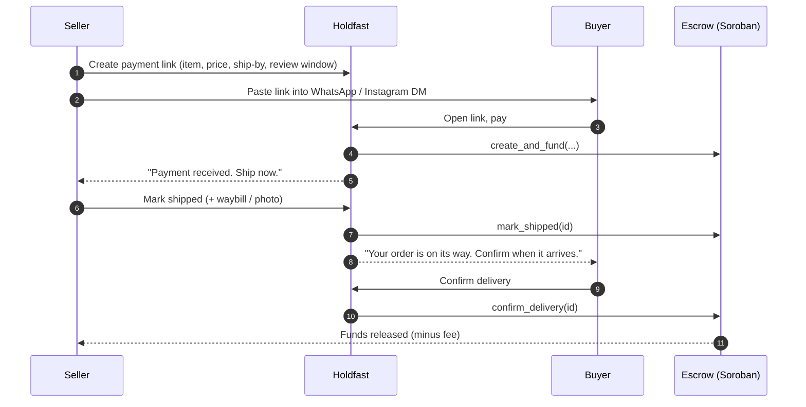
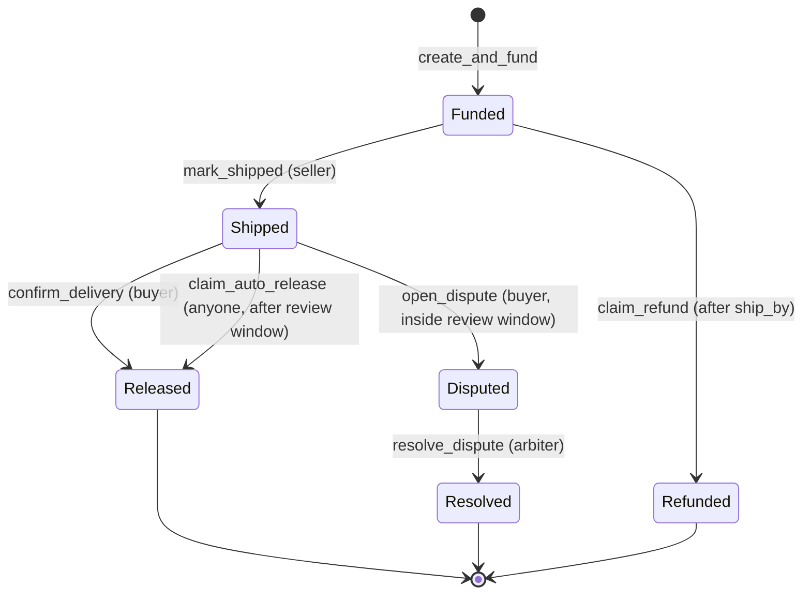
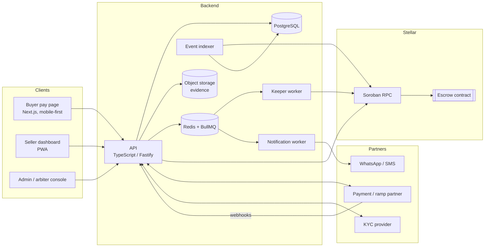

<div align="center">

# 🔒 Holdfast

**Escrow for Instagram and WhatsApp sellers, built on Stellar / Soroban.**

A seller drops a payment link into a DM. The buyer pays. Funds are held until the buyer confirms delivery, a timer runs out, or a human arbiter settles a dispute. Every seller builds a verifiable track record along the way.


-black)


</div>

> **Status: pre-alpha / design phase.** Nothing here has been audited, and nothing should hold real money until it has been. See [Security](#security), [Regulatory notes](#regulatory-notes-nigeria-first) and [Roadmap](#roadmap).

---

## Table of contents

1. [The problem](#the-problem)
2. [What Holdfast does](#what-holdfast-does)
3. [Core concepts](#core-concepts)
4. [How it works](#how-it-works)
5. [Architecture](#architecture)
6. [Money-flow modes](#money-flow-modes)
7. [Smart contract specification](#smart-contract-specification)
8. [Off-chain services](#off-chain-services)
9. [Data model](#data-model)
10. [API reference (draft)](#api-reference-draft)
11. [Seller reputation](#seller-reputation)
12. [Dispute resolution](#dispute-resolution)
13. [Fraud and abuse controls](#fraud-and-abuse-controls)
14. [Regulatory notes (Nigeria first)](#regulatory-notes-nigeria-first)
15. [Tech stack](#tech-stack)
16. [Repository layout](#repository-layout)
17. [Getting started](#getting-started)
18. [Configuration](#configuration)
19. [Testing](#testing)
20. [Deployment](#deployment)
21. [Security](#security)
22. [Roadmap](#roadmap)
23. [Open questions](#open-questions)
24. [Contributing](#contributing)
25. [License and disclaimer](#license-and-disclaimer)

---

## The problem

Millions of people buy and sell through Instagram and WhatsApp DMs. Payment today is a bank transfer sent on trust, and both sides carry risk:

- **Buyers** send money first and sometimes receive nothing, or receive the wrong item.
- **Sellers** lose sales to buyers who don't trust them enough to pay in advance, and they have no portable proof of good behaviour.
- **Everyone** has to resolve disagreements over chat screenshots, with no neutral party.

Storefront platforms solve this by forcing sellers to leave the chat. Holdfast keeps the sale where it already happens, in the DM, and adds protection as a link.

## What Holdfast does

- **Payment links.** A seller creates a link (item, price, delivery window) and pastes it into the chat. No storefront and no buyer account are needed.
- **Held funds.** The buyer pays, but the money is not released to the seller until delivery is confirmed.
- **Three exits.** Every order ends in one of three ways: *release* (buyer confirms, or the review window passes without a dispute), *refund* (the seller never ships), or *arbitration* (the buyer disputes).
- **Auditable state.** Order state transitions are enforced by a Soroban smart contract and emitted as events, so history can't be quietly rewritten.
- **Seller track record.** Completed orders, dispute rate and response time are computed from those events and shown as a public profile and shareable badge.
- **Mobile-first and chain-hidden.** Buyers and sellers should never need to know what Stellar is, hold XLM, or manage a seed phrase.

## Core concepts

| Term | Meaning |
|---|---|
| **Order** | One purchase, from payment to final settlement. Exactly one order lives behind each payment link use. |
| **Buyer / Seller** | The two parties. Buyers are lightweight (phone number and payment); sellers are KYC-verified. |
| **Arbiter** | A human (initially the founding team) who resolves disputes. On-chain this is a multisig account. |
| **Ship-by deadline** | The time by which the seller must mark the order shipped, or the buyer can claim a refund. |
| **Review window** | The period after shipping in which the buyer can confirm or dispute. When it ends with no dispute, funds auto-release. |
| **Keeper** | An off-chain worker that submits time-based contract calls (auto-release, refund). It is a convenience, not a trust point, because these calls are permissionless. |
| **Sponsor** | A backend account that pays Stellar fees and reserves on behalf of users. |

## How it works

### Happy path



### Order state machine



An order is in exactly one state at any time. Every transition is logged on-chain as an event and mirrored in the database audit log. **That table of transitions is the product.**

### Rules at a glance

| Situation | What happens |
|---|---|
| Buyer pays | Funds are held. Seller is told to ship. |
| Seller ships in time | Buyer's review window starts. |
| Buyer confirms delivery | Funds go to the seller, minus the platform fee. |
| Buyer does nothing | After the review window, anyone can trigger auto-release. |
| Seller never ships by the deadline | Buyer can claim a full refund. |
| Buyer disputes inside the window | Funds freeze. An arbiter decides the split. |
| Arbiter resolves | Funds are split as decided. The outcome feeds both parties' reputation. |

## Architecture



**Design principles**

1. **The contract owns the rules, Postgres owns the queries.** The chain enforces who can do what and when. The database serves dashboards, search, and reputation.
2. **Time-based actions are permissionless.** Anyone can call `claim_auto_release` and `claim_refund` once their conditions are met, so a dead keeper can't hold funds hostage.
3. **Users never touch the chain.** Fees and reserves are sponsored, and wallets are abstracted (custodial first, passkeys later).
4. **Everything is idempotent.** Webhooks, keeper submissions and indexer reads can be retried safely.
5. **Start small, stay human.** Low order caps, KYC-tiered sellers, and a human arbiter, before any automation.

## Money-flow modes

Holdfast supports two ways of holding funds. Which one you run depends on your market and licensing position.

### Mode A: local-currency rails, contract as state and reputation layer *(recommended for v1)*

- The buyer pays in local currency (for example naira by bank transfer) into an account held by a **licensed payment partner**.
- The partner holds the funds. Holdfast instructs the release or refund through the partner's API.
- The Soroban contract does not hold tokens. It records each order's state transitions and acts as the tamper-evident source for seller reputation.
- Advantages: no stablecoin conversion legs, no FX spread, simplest user experience, and a lighter regulatory footprint.
- Trade-off: the *money* part of the guarantee depends on the partner and on Holdfast's own backend, not on the contract alone.

### Mode B: on-chain stablecoin escrow

- The buyer pays local currency, a ramp partner converts it to USDC, and the contract holds the USDC.
- Release, refund and resolution are enforced by the contract. The seller can withdraw USDC to local currency through an anchor or ramp.
- Advantages: trust-minimised custody, with permissionless timeouts.
- Trade-offs: two conversion legs with fees and spread, price risk between funding and payout, and a heavier regulatory position.

### Mode C: opt-in USDC escrow

Offer Mode B as an option next to Mode A for crypto-native buyers and sellers, once the contract is audited.

> **Pricing in Mode B.** Pick one convention and show it clearly: quote in USD (the seller's naira payout varies), or lock the local-currency value at payment time (the seller's USD value varies). Don't leave this implicit.

## Smart contract specification

The contract lives in [`contracts/escrow`](./contracts/escrow) and is written in Rust against `soroban-sdk`.

### Roles

| Role | How it's identified | Can do |
|---|---|---|
| Buyer | Address stored on the order | `confirm_delivery`, `open_dispute` |
| Seller | Address stored on the order | `mark_shipped` |
| Arbiter | Contract-level address (multisig account) | `resolve_dispute` |
| Admin | Contract-level address (multisig) | `set_fee_bps`, `set_treasury`, `pause`, `unpause` |
| Anyone | Any address | `claim_auto_release`, `claim_refund`, read functions |

### Types

```rust
#[contracttype]
#[derive(Clone, Copy, PartialEq, Eq)]
pub enum Status {
    Funded,
    Shipped,
    Released,
    Refunded,
    Disputed,
    Resolved,
}

#[contracttype]
pub struct Order {
    pub buyer: Address,
    pub seller: Address,
    pub token: Address,      // SEP-41 token (e.g. USDC)
    pub amount: i128,        // in the token's smallest unit
    pub ship_by: u64,        // ledger timestamp (seconds)
    pub review_secs: u64,    // buyer's window after shipping
    pub shipped_at: u64,     // 0 until shipped
    pub status: Status,
}

#[contracttype]
pub enum DataKey {
    Order(u64),
    Counter,
    Arbiter,
    Admin,
    Treasury,
    FeeBps,
    Paused,
}
```

### Functions

| Function | Caller | Preconditions | Effect |
|---|---|---|---|
| `create_and_fund(buyer, seller, token, amount, ship_by, review_secs) -> u64` | Buyer | Contract not paused, `amount > 0`, `ship_by` in the future, `review_secs` within allowed bounds, `amount` under the configured cap | Transfers `amount` from buyer to contract, stores order as `Funded`, returns the order ID |
| `mark_shipped(id)` | Seller | Status `Funded`, now ≤ `ship_by` | Sets `Shipped`, records `shipped_at` |
| `confirm_delivery(id)` | Buyer | Status `Shipped` | Sets `Released`, pays seller `amount - fee`, pays fee to treasury |
| `claim_auto_release(id)` | Anyone | Status `Shipped`, now > `shipped_at + review_secs` | Same payout as `confirm_delivery` |
| `claim_refund(id)` | Anyone | Status `Funded`, now > `ship_by` | Sets `Refunded`, returns full amount to buyer (no fee) |
| `open_dispute(id)` | Buyer | Status `Shipped`, now ≤ `shipped_at + review_secs` | Sets `Disputed`, freezes funds |
| `resolve_dispute(id, buyer_share, seller_share)` | Arbiter | Status `Disputed`, `buyer_share + seller_share == amount` | Sets `Resolved`, pays each side its share, fee charged on the seller's share only |
| `get_order(id)` | Anyone | None | Returns the order |
| `pause()` / `unpause()` | Admin | None | Blocks `create_and_fund` only. Existing orders can always settle. |

### Events

Every transition emits an event with the order ID and the actors, for example:

```
("order", "funded")    -> (id, buyer, seller, token, amount, ship_by)
("order", "shipped")   -> (id, shipped_at)
("order", "released")  -> (id, to_seller, fee, how)   // how = confirmed | auto
("order", "refunded")  -> (id, amount)
("order", "disputed")  -> (id, opened_at)
("order", "resolved")  -> (id, buyer_share, seller_share, fee)
```

The indexer consumes these to build reputation and mirror state into Postgres.

### Design decisions and invariants

- **Create and fund in one call.** This removes a `Created` state and a whole class of "unfunded order" edge cases.
- **Effects before interactions.** State is updated to its final value *before* any token transfer in every function.
- **Pause never traps funds.** Pausing stops new orders only. Settlement paths stay open.
- **Fee bounds.** `fee_bps` is capped in code (for example ≤ 500), and the fee applies to payouts only.
- **Conservation.** For every terminal state, the amounts paid out sum exactly to `amount`. This is a property test.
- **Storage TTL.** Every order write extends the entry's TTL well beyond the longest possible order lifetime. State archival must never be a way to strand funds.
- **Authorization.** Each role check uses `require_auth()` on the stored address, not on a caller-supplied one.
- **No arbiter timeout (yet).** See [Open questions](#open-questions).

## Off-chain services

### API

The TypeScript API handles authentication, payment-link management, partner webhooks, evidence uploads, and the arbiter console. It builds, simulates and submits Soroban transactions, and it holds no money itself.

### Keeper

A scheduled worker that:

1. Scans for orders where `status = funded` and `ship_by` has passed, then submits `claim_refund`.
2. Scans for orders where `status = shipped`, the review window has passed, and no dispute exists, then submits `claim_auto_release`.
3. Retries with backoff, treats "already settled" errors as success, and alerts when any order sits past its deadline by more than a configured margin.

Because these calls are permissionless, anyone can run a keeper. Holdfast runs the default one.

### Event indexer

Polls the Soroban RPC `getEvents` endpoint with a persisted cursor, writes every transition to `order_events`, and updates the `orders` projection. Public RPC nodes only retain a limited window of history, so the indexer must run continuously and persist its cursor. For backfill beyond that window, use an archive-capable provider or a hosted indexer.

### Sponsor / fee-bump service

Pays Stellar fees and base reserves for users via fee-bump transactions and sponsored reserves, and creates the USDC trustline during account setup. **The sponsor key lives in a KMS or HSM, never in an environment file.** The service enforces per-account and per-day spending limits and alerts on a low balance.

### Notifications

Template-based WhatsApp (Business API) messages with SMS fallback, triggered by order events:

- Seller: payment received, ship-by reminder, buyer confirmed, funds released.
- Buyer: payment received, shipped, confirm-delivery reminder, auto-release warning, refund issued.
- Arbiter: new dispute assigned.

### Evidence storage

Photos, videos and documents go to S3-compatible object storage. On upload, the server computes a SHA-256 hash and stores it with the order, so any later dispute can prove the evidence wasn't altered.

## Data model

Postgres is the system of record for everything the chain doesn't need to know. A simplified schema:

```sql
CREATE TABLE users (
  id            uuid PRIMARY KEY DEFAULT gen_random_uuid(),
  phone_e164    text UNIQUE NOT NULL,
  role          text NOT NULL CHECK (role IN ('buyer','seller','arbiter','admin')),
  stellar_addr  text UNIQUE,
  created_at    timestamptz NOT NULL DEFAULT now()
);

CREATE TABLE sellers (
  user_id       uuid PRIMARY KEY REFERENCES users(id),
  handle        text UNIQUE NOT NULL,          -- public profile slug
  kyc_tier      smallint NOT NULL DEFAULT 0,   -- 0 = unverified
  kyc_ref       text,                          -- provider reference, not raw ID data
  payout_ref    text,                          -- verified bank account reference
  created_at    timestamptz NOT NULL DEFAULT now()
);

CREATE TABLE payment_links (
  id            uuid PRIMARY KEY DEFAULT gen_random_uuid(),
  slug          text UNIQUE NOT NULL,
  seller_id     uuid NOT NULL REFERENCES sellers(user_id),
  title         text NOT NULL,
  amount_minor  bigint NOT NULL,               -- smallest currency unit
  currency      text NOT NULL,
  ship_by_hours integer NOT NULL,
  review_hours  integer NOT NULL,
  expires_at    timestamptz,
  created_at    timestamptz NOT NULL DEFAULT now()
);

CREATE TABLE orders (
  id            uuid PRIMARY KEY DEFAULT gen_random_uuid(),
  chain_id      bigint UNIQUE,                 -- contract order ID, null in Mode A
  link_id       uuid NOT NULL REFERENCES payment_links(id),
  buyer_phone   text NOT NULL,
  seller_id     uuid NOT NULL REFERENCES sellers(user_id),
  amount_minor  bigint NOT NULL,
  currency      text NOT NULL,
  status        text NOT NULL,
  ship_by       timestamptz NOT NULL,
  shipped_at    timestamptz,
  review_ends   timestamptz,
  created_at    timestamptz NOT NULL DEFAULT now()
);

-- Append-only. Never updated, never deleted.
CREATE TABLE order_events (
  id            bigserial PRIMARY KEY,
  order_id      uuid NOT NULL REFERENCES orders(id),
  from_status   text,
  to_status     text NOT NULL,
  actor         text NOT NULL,                 -- buyer | seller | arbiter | keeper | system
  tx_hash       text,                          -- on-chain transaction, if any
  note          jsonb,
  created_at    timestamptz NOT NULL DEFAULT now()
);

CREATE TABLE evidence (
  id            uuid PRIMARY KEY DEFAULT gen_random_uuid(),
  order_id      uuid NOT NULL REFERENCES orders(id),
  uploaded_by   text NOT NULL,
  object_key    text NOT NULL,
  sha256        text NOT NULL,
  created_at    timestamptz NOT NULL DEFAULT now()
);

CREATE TABLE disputes (
  id            uuid PRIMARY KEY DEFAULT gen_random_uuid(),
  order_id      uuid UNIQUE NOT NULL REFERENCES orders(id),
  reason        text NOT NULL,
  opened_at     timestamptz NOT NULL DEFAULT now(),
  arbiter_id    uuid REFERENCES users(id),
  buyer_share   bigint,
  seller_share  bigint,
  resolution    text,
  resolved_at   timestamptz
);

CREATE TABLE payouts (
  id            uuid PRIMARY KEY DEFAULT gen_random_uuid(),
  order_id      uuid NOT NULL REFERENCES orders(id),
  party         text NOT NULL CHECK (party IN ('seller','buyer')),
  amount_minor  bigint NOT NULL,
  partner_ref   text UNIQUE,                   -- idempotency key with the partner
  status        text NOT NULL,
  created_at    timestamptz NOT NULL DEFAULT now()
);
```

Rules: money columns are integers in minor units (no floats), `order_events` is append-only, and personal data (BVN/NIN-style identifiers) is never stored raw, only verification results and provider references.

## API reference (draft)

Base path `/v1`. All responses are JSON. Authenticated routes use short-lived bearer tokens issued after phone OTP.

### Auth and sellers

| Method | Path | Description |
|---|---|---|
| `POST` | `/auth/otp/request` | Send an OTP to a phone number |
| `POST` | `/auth/otp/verify` | Exchange OTP for an access token |
| `POST` | `/sellers` | Create a seller profile (handle, business name) |
| `POST` | `/sellers/kyc` | Start KYC with the provider |
| `PUT`  | `/sellers/payout-account` | Set and verify the payout bank account |
| `GET`  | `/sellers/:handle/reputation` | Public reputation summary |

### Links and orders

| Method | Path | Description |
|---|---|---|
| `POST` | `/links` | Create a payment link |
| `GET`  | `/links/:slug` | Public: link details for the pay page |
| `POST` | `/links/:slug/orders` | Start an order. Returns payment instructions (for example a per-order virtual account) |
| `GET`  | `/orders/:id` | Order status (buyer by signed token, seller by auth) |
| `POST` | `/orders/:id/ship` | Seller marks shipped (waybill / photo optional) |
| `POST` | `/orders/:id/confirm` | Buyer confirms delivery |
| `POST` | `/orders/:id/dispute` | Buyer opens a dispute with a reason |
| `POST` | `/orders/:id/evidence` | Upload evidence (multipart) |

### Admin / arbiter

| Method | Path | Description |
|---|---|---|
| `GET`  | `/admin/disputes` | Open disputes queue |
| `GET`  | `/admin/disputes/:id` | Full case: timeline, evidence, chat context provided |
| `POST` | `/admin/disputes/:id/resolve` | Submit `buyer_share` and `seller_share` and a written rationale |

### Webhooks and public assets

| Method | Path | Description |
|---|---|---|
| `POST` | `/webhooks/payments` | Payment partner events (signature-verified, idempotent) |
| `POST` | `/webhooks/kyc` | KYC provider results |
| `GET`  | `/badge/:handle.svg` | Shareable seller badge |

## Seller reputation

Reputation is **derived data**: computed from indexed on-chain events, so sellers can't edit it and Holdfast can't quietly rewrite it.

**Signals**

- Completed orders (lifetime and trailing 90 days)
- Total volume band (not exact amounts)
- Dispute rate = disputed orders ÷ shipped orders
- Disputes lost = arbiter resolutions mostly in the buyer's favour
- Median time to ship
- Median response time to the first notification
- Account age and KYC tier

**Rules for a fair score**

- Don't show a rate until a minimum sample (for example 10 orders), and show "New seller" before that.
- Smooth small samples so one dispute doesn't define a seller with three orders.
- Weight recent behaviour more than old.
- Show the underlying counts next to any badge so sellers can't be misrepresented by a single number.

**Surfaces**

- Public profile at `/s/{handle}`
- A server-rendered SVG badge sellers can paste into an Instagram bio or WhatsApp business profile
- "Verified by Holdfast" marker for KYC tier ≥ 1, shown separately from performance so it isn't mistaken for a quality score

## Dispute resolution

Dispute handling is the hardest part to scale. v1 is deliberately manual.

**Flow**

1. The buyer opens a dispute inside the review window, choosing a reason (not received, not as described, damaged, other) and attaching evidence.
2. Funds freeze on-chain. Both parties are notified and the seller has a fixed period to respond with evidence.
3. The arbiter reviews the timeline (payment, shipping proof, tracking or waybill, delivery confirmation, all evidence with hashes, and any chat screenshots) in the admin console.
4. The arbiter submits a split (`buyer_share`, `seller_share`) and a written rationale. The on-chain call is signed through the multisig.
5. Both parties are notified with the rationale. The outcome feeds reputation.

**Guardrails**

- Published policy for what qualifies as "not as described", what evidence counts, and typical outcomes.
- Case notes are kept for every decision, to build precedent and calibrate future rules.
- Two-person sign-off above a value threshold.
- SLA targets per case, tracked on a dashboard.
- Start with small orders only. What you learn here decides what to automate later, such as courier-tracking auto-resolution or a staked reviewer panel.

## Fraud and abuse controls

| Threat | Mitigation |
|---|---|
| Seller ships an empty box or fakes a waybill | Seller KYC, payout caps for new sellers, photo or video evidence at shipping, evidence hashing, payout hold for new sellers |
| Buyer falsely claims non-delivery | Shipping evidence required, dispute only inside the window, repeat-dispute detection, buyer-side dispute-rate tracking |
| Fake accounts and mule sellers | Phone plus ID verification, verified payout account name must match the KYC name, velocity limits |
| Link abuse and bot probing | Rate limiting, bot protection at the edge, short link slugs with enough entropy |
| Going off-platform after trust is built | The product answer is value: buyer protection and a visible badge that's worth the fee |
| Sponsor-account drain | Per-account and per-day fee budgets, alerts, key in KMS/HSM |
| Arbiter key compromise | Multisig with hardware keys, order value caps, pause switch |
| Chargebacks | Prefer bank-transfer and wallet rails over cards; hold new-seller payouts longer |

## Regulatory notes (Nigeria first)

> **This is not legal advice.** The rules below were checked in October 2026 and are changing. Get an opinion from a Nigerian fintech lawyer before launch.

- **Holding other people's money is a regulated activity.** The safe pattern is to operate through licensed partners, and not to pool customer funds yourself.
- **SEC and CBN split.** The SEC supervises securities-type virtual assets. The CBN supervises payment, settlement and custody for non-security virtual assets. An escrow sits closer to the CBN side.
- **Framework in flux.** As of mid-2026 no firm held a full VASP licence, a July 2026 Executive Order created a coordinating Virtual Asset Council, and SEC stablecoin rules were proposed in August 2026 but not final.
- **CBN sandbox.** Cohort 2 has a VASP track covering stablecoin payments, wallets, custody and on- and off-ramps. It's the route for running your own flow instead of renting a partner's licence.
- **Partner risk.** Banks are required to freeze VASP accounts whose KYC or licence status is invalid. Pick partners with clear licensing, and keep a backup.
- **Data protection.** BVN/NIN-style identifiers fall under Nigeria's data protection law. Store verification outcomes and references, not raw identity data, and handle consent and retention properly.

### Recommended v1 posture

1. **Mode A** with a licensed collection and payout partner.
2. Soroban used for state and reputation, with low order caps.
3. Mode B/C only after a legal opinion, an audit, and clearer stablecoin rules.

### Partner shortlist (verify current terms and licensing for each)

| Need | Candidates |
|---|---|
| Naira collection (per-order virtual accounts, pay-by-transfer) | Paystack, Flutterwave, Monnify, Squad, Korapay |
| Naira payouts and account-name resolution | The same providers' transfer APIs |
| USDC on/off-ramp (Mode B/C) | Yellow Card, Paychant, Daya, Stellar SEP-24 anchors that serve NGN |
| Seller KYC | Smile ID, Dojah, Prembly, Youverify |
| WhatsApp | Meta WhatsApp Cloud API, or a local business service provider |
| SMS / OTP | Termii, Africa's Talking |

The first thing to ask each collection provider: **can you hold funds for a set period, or settle on instruction?** The answer decides whether Mode A works with them.

### Seller tiers (illustrative, configurable)

| Tier | Requirements | Limits |
|---|---|---|
| 0 | Phone verified | Cannot receive payments |
| 1 | Phone, ID verification, verified payout account | Low per-order cap, low daily payout cap, longer payout hold |
| 2 | Tier 1 plus completed orders and a clean dispute record | Higher caps, shorter hold |
| 3 | Business verification and a strong track record | Highest caps |

## Tech stack

| Layer | Choice |
|---|---|
| Smart contract | Rust, `soroban-sdk`, Stellar CLI |
| Backend | TypeScript, Node.js, Fastify, Zod |
| Database | PostgreSQL, Drizzle (or Prisma) |
| Queues | Redis, BullMQ |
| Chain access | `@stellar/stellar-sdk`, Soroban RPC |
| Wallets | Custodial managed accounts in v1, passkey smart wallets later |
| Frontend | Next.js, Tailwind CSS, PWA for the seller dashboard |
| Storage | S3-compatible (S3 or Cloudflare R2) |
| Messaging | WhatsApp Business API, SMS fallback, transactional email |
| Infra | Docker, GitHub Actions, a managed host to start, a KMS for secrets |
| Observability | Sentry, Prometheus/Grafana or a hosted uptime tool |

## Repository layout

```
holdfast/
├── contracts/
│   └── escrow/                 # Soroban contract (Rust)
│       ├── src/
│       │   ├── lib.rs
│       │   ├── types.rs
│       │   ├── errors.rs
│       │   ├── events.rs
│       │   └── test.rs         # unit and property tests
│       └── Cargo.toml
├── apps/
│   ├── api/                    # Fastify API
│   ├── web/                    # Buyer pay page, seller PWA, admin console (Next.js)
│   └── worker/                 # Keeper, indexer, notifications, sponsor
├── packages/
│   ├── contract-client/        # Generated TypeScript bindings for the contract
│   ├── db/                     # Schema and migrations
│   └── shared/                 # Types, money helpers, validation
├── infra/
│   ├── docker-compose.yml
│   └── terraform/              # Optional, later
├── docs/
│   ├── architecture.md
│   ├── dispute-policy.md
│   ├── runbooks/               # Keeper down, sponsor low, stuck order
│   └── threat-model.md
├── scripts/
│   ├── deploy-testnet.sh
│   └── seed.ts
├── .github/workflows/
├── LICENSE
└── README.md
```

## Getting started

### Prerequisites

- Rust (stable) with the `wasm32v1-none` target, or `wasm32-unknown-unknown` for older toolchains
- [Stellar CLI](https://developers.stellar.org/docs/tools/cli)
- Node.js 20+ and pnpm
- Docker (for Postgres and Redis)

### 1. Clone and install

```bash
git clone https://github.com/<your-org>/holdfast.git
cd holdfast
pnpm install
```

### 2. Start local services

```bash
docker compose -f infra/docker-compose.yml up -d
```

A minimal `infra/docker-compose.yml`:

```yaml
services:
  postgres:
    image: postgres:16
    environment:
      POSTGRES_USER: holdfast
      POSTGRES_PASSWORD: holdfast
      POSTGRES_DB: holdfast
    ports: ["5432:5432"]
    volumes: ["pgdata:/var/lib/postgresql/data"]
  redis:
    image: redis:7
    ports: ["6379:6379"]
volumes:
  pgdata:
```

### 3. Build and test the contract

```bash
cd contracts/escrow
cargo test
stellar contract build
```

### 4. Create testnet identities and deploy

```bash
stellar keys generate deployer --network testnet --fund
stellar keys generate arbiter  --network testnet --fund
stellar keys generate treasury --network testnet --fund

stellar contract deploy \
  --wasm target/wasm32v1-none/release/escrow.wasm \
  --source-account deployer \
  --network testnet
```

Initialize the contract with the arbiter, admin, treasury, and fee, then copy the contract ID into your `.env` (see [Configuration](#configuration)). The exact initializer arguments are defined in `contracts/escrow/src/lib.rs`.

### 5. Migrate the database and run the apps

```bash
cp .env.example .env              # then edit values
pnpm --filter @holdfast/db migrate
pnpm dev                          # runs api, web and worker
```

### 6. Try the flow on testnet

1. Create a seller and a payment link in the dashboard.
2. Open the link as a buyer and pay using the **sandbox** payment partner.
3. Mark the order shipped, then confirm delivery as the buyer.
4. Repeat, but let the timers run (use short `ship_by` and `review_secs` values in dev) to watch the keeper settle the order.
5. Open a dispute and resolve it from the admin console.

## Configuration

Copy `.env.example` to `.env`. Never commit real secrets.

| Variable | Description |
|---|---|
| `DATABASE_URL` | Postgres connection string |
| `REDIS_URL` | Redis connection string |
| `STELLAR_NETWORK` | `testnet` or `mainnet` |
| `STELLAR_RPC_URL` | Soroban RPC endpoint |
| `STELLAR_NETWORK_PASSPHRASE` | Network passphrase for the chosen network |
| `ESCROW_CONTRACT_ID` | Deployed escrow contract ID |
| `USDC_ASSET_CONTRACT_ID` | Token contract for the settlement asset (Mode B/C) |
| `SPONSOR_KMS_KEY_ID` | KMS reference for the fee-sponsor key (production) |
| `SPONSOR_SECRET` | Local-dev only. Never use in production. |
| `KEEPER_SECRET` | Local-dev only. Account used to submit timeout calls |
| `PAYMENT_PROVIDER` | Which partner adapter to load |
| `PAYMENT_PROVIDER_KEY` | Partner API key |
| `PAYMENT_WEBHOOK_SECRET` | Signature secret for partner webhooks |
| `KYC_PROVIDER_KEY` | KYC provider key |
| `WHATSAPP_TOKEN` / `SMS_API_KEY` | Messaging credentials |
| `STORAGE_ENDPOINT` / `STORAGE_BUCKET` / `STORAGE_KEY` / `STORAGE_SECRET` | Evidence storage |
| `JWT_SECRET` | Signing key for access tokens |
| `MAX_ORDER_AMOUNT_MINOR` | Global order cap (start low) |
| `FEE_BPS` | Platform fee in basis points |

## Testing

### Contract

- **Unit tests** for every transition and every rejection path (wrong caller, wrong state, wrong time).
- **Time tests** that move `env.ledger()` forward to exercise `ship_by`, review windows and auto-release.
- **Auth tests** that check each function with and without the required signature.
- **Property tests** for conservation (payouts always sum to the funded amount), fee bounds, and that terminal states are final.
- **Pause tests**: paused contracts reject new orders but still settle existing ones.
- **TTL tests**: entries survive beyond the longest allowed order lifetime.

```bash
cd contracts/escrow && cargo test
```

### Backend

- Webhook idempotency (duplicate and out-of-order events).
- Keeper behaviour when the chain call fails, when the order is already settled, and when the RPC is slow.
- Indexer cursor recovery after a restart.
- Reputation calculations against fixtures with known results.

### End to end

A scripted run on testnet covering the happy path, refund, auto-release and dispute, executed in CI on every merge to `main`.

## Deployment

1. **Testnet** is the default for every environment until the checklist below is complete.
2. **Staging** runs against testnet with sandbox partner credentials.
3. **Mainnet** requires all of:
   - [ ] Independent smart contract audit, with findings resolved
   - [ ] Legal opinion on the chosen money-flow mode
   - [ ] Signed agreements with licensed partners
   - [ ] Multisig for arbiter and admin, with hardware keys
   - [ ] Sponsor and keeper keys in a KMS or HSM
   - [ ] Order caps and seller tier limits configured
   - [ ] Monitoring and alerting live (keeper lag, sponsor balance, stuck orders, webhook failures)
   - [ ] Runbooks written and rehearsed
   - [ ] Published dispute policy and refund terms

## Security

- **Audit before funds.** Contracts are permanent in effect. No real money until an external audit is done.
- **Keys.** Arbiter and admin are multisig accounts with hardware-backed signers. Sponsor and keeper keys live in a KMS or HSM. Rotate regularly.
- **Caps.** Per-order and per-day caps limit the blast radius of any bug.
- **Pause switch.** Blocks new orders and leaves settlement open.
- **Upgrades.** Decide the upgrade policy deliberately: an upgradeable contract is easier to fix, but it adds a trust assumption. Document whichever you choose.
- **Backend.** Verify every webhook signature, enforce idempotency keys, validate all input with schemas, and rate-limit public routes.
- **Privacy.** Minimise personal data, encrypt at rest, never log identity documents, and restrict arbiter access to what a case needs.
- **Responsible disclosure.** Report vulnerabilities privately to `security@<your-domain>` (to be set up before launch). Please don't open public issues for security bugs.

## Roadmap

**Phase 0: Foundations**
- [ ] Legal opinion and partner conversations
- [ ] Contract with a full test suite on testnet
- [ ] Order state machine and audit log in the backend

**Phase 1: Closed pilot (testnet, then limited live)**
- [ ] Payment link page and Mode A flow with one partner
- [ ] Seller signup, KYC tiers, payout verification
- [ ] Keeper, indexer, sponsor service
- [ ] WhatsApp/SMS notifications
- [ ] Admin dispute console
- [ ] Pilot with 5–10 real sellers on small orders

**Phase 2: Trust layer**
- [ ] Public seller profiles and badge
- [ ] Reputation scoring and anti-gaming rules
- [ ] Evidence flows (shipping photos and video, hashing)
- [ ] Published dispute policy

**Phase 3: Scale**
- [ ] Opt-in USDC escrow (Mode C) after audit
- [ ] Passkey smart wallets
- [ ] Courier and dispatch integrations where tracking is reliable
- [ ] Partial automation of simple disputes
- [ ] More countries and currencies

## Open questions

- **Arbiter timeout.** If the arbiter never resolves a dispute, what happens? Options: a default split after N days, escalation to a second arbiter, or funds remain frozen. Each has trust trade-offs.
- **Partial release.** Should buyers be able to accept part of an order, or should it be all-or-nothing?
- **Price convention in Mode B.** Quote in USD, or lock local-currency value?
- **Buyer identity.** How much verification, if any, should buyers need above a certain order size?
- **Fee model.** Percentage with a minimum, paid by the seller, the buyer, or split?
- **Upgradeability.** Immutable contract versus an upgrade path with governance.
- **Instagram-specific flows.** In-app browser limits on payment pages and deep links.

## Contributing

Contributions are welcome once the foundations are stable. Until then, the most useful help is review of the contract design, the dispute policy, and the regulatory assumptions.

1. Fork the repo and create a branch (`feat/...`, `fix/...`).
2. Run `cargo test` and `pnpm test` before opening a PR.
3. Keep PRs focused and describe the *why*, not only the *what*.
4. Contract changes need tests for every new path, plus a note on security impact.

A `CODE_OF_CONDUCT.md` and `CONTRIBUTING.md` will follow.

## License and disclaimer

Licensed under the [Apache License 2.0](./LICENSE).

**Disclaimer.** Holdfast is experimental software. It is provided as is, without warranty. Nothing in this repository is legal, financial, or regulatory advice. Operating an escrow or payment service is regulated in most jurisdictions, and anyone deploying this software is solely responsible for obtaining the required licences and for complying with applicable law.
